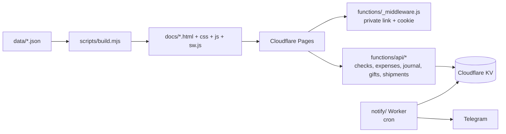

# Japan Trip Planner

[Türkçe](README.md) · **English**

A personal, phone-first website built for a two-person trip to Japan (Osaka · Kyoto · Nara · Tokyo). Day-by-day itinerary, map, shopping list, shared expense log, travel guide and Telegram notifications in one place.

A dependency-free Node script generates a static site from JSON data. The site runs on Cloudflare Pages behind a private link. Checkmarks, expenses and the journal are shared between two phones (Cloudflare KV).

> **The site's interface and content are in Turkish.** All text comes from the JSON files and the page templates, so you can adapt it to another language and destination.

> **Sample data:** This repository is a copy of a private project made for a real trip, with personal information removed. Names (Ali, Ayşe), hotels ("Örnek Otel" = "Sample Hotel"), flight numbers and dates (2037) are fictional. There are no booking codes, tickets, passport or phone numbers. Places, shops, prices and rules were compiled from official sources in autumn 2026; check that they are still current before relying on them.

<p align="center">
  
  
</p>

## Features

| | |
|---|---|
| **Itinerary** (Program) | Day cards: timed stops, transit legs (line, station, direction, approximate minutes), things to buy that day, rain plan, meeting point, crowd and walking estimates. Google/Apple Maps directions for every stop. |
| **Map** (Harita) | Leaflet map with sights, shops, restaurants and hotels. Route of the day, your location, and an "open nearby right now" view (opening hours from `hours.json`). |
| **Shopping** (Alışveriş) | Categorised product list: Japan price, TRY equivalent, comparison with Turkish prices, source link, "whose list" tag, coupons, tax-free notes. Checkmarks are shared between both phones. |
| **Recommendations** (Öneriler) | Restaurants, shops and special places; reservation guide; Wikimedia Commons photos (with photographer and licence). |
| **Travel** (Yolculuk) | Flights, step-by-step transit timeline, power bank / medicine / drone rules, eSIM comparison, luggage plan, jet lag plan, checklist. |
| **Expenses** (Harcama) | Shared expense log: person, category, yen/TRY, receipt photo, tax-free receipt list, CSV report. |
| **Practical** (Pratik) | Taxi card, Japanese phrases, camera translation guide, emergency card, yen↔TRY converter, reminder calendar. |
| **Journal** (Günlük) | Notes and photos per day (resized on the phone, stored in KV). |
| **Booklet** (Kitapçık) | Printable / PDF version of the whole plan. |
| **Search** | One search box across all pages (sections, cards, days). |

Also: dark/light theme, offline use (service worker), hiding and restoring completed items, and a "whose phone is this?" setting.

## Screenshots

| Itinerary | Map |
|---|---|
|  |  |
| **Shopping** | **Travel** |
|  |  |
| **Recommendations** | **Practical** |
|  |  |
| **Expenses** | |
|  | |

## How it works



- **Data:** All content lives in JSON files under `data/` (`trip.json` timed itinerary, `plan.json` day cards, `mustbuy.json` / `shopping.json` shopping, `picks.json` recommendations, `transport.json` transit legs, `travel.json` travel, `pratik.json` reminders…). Schema: [SCHEMA.md](SCHEMA.md) (Turkish).
- **Build:** `scripts/build.mjs` writes the pages, hashed CSS/JS, the search index and the service worker to `docs/` with no dependencies.
- **Access:** `functions/_middleware.js` protects the whole site. Opening a `?k=<key>` link once sets a one-year cookie; only the SHA-256 hash of the key is stored in the code.
- **Shared data:** the `functions/api/*` endpoints keep checkmarks, expenses, the journal, gift and shipment lists in KV.
- **Notifications:** the `notify/` Worker sends morning/evening Telegram summaries on a cron (stops of the day, weather, reservations, things to buy). During the trip it checks every 10 minutes for earthquake (P2P地震情報) and train disruption alerts.

## Use it for your own trip

```bash
npm run build
```

```bash
npm test
```

```bash
npm start
```

`npm start` serves the site locally at `http://127.0.0.1:4173`. For a new trip, replace the files in `data/` with your own plan; the tests check for time conflicts, broken links and source keys. To have an AI assistant rebuild the whole system from scratch, see [PRD.md](PRD.md) (Turkish).

### Deploying to Cloudflare

1. Create a KV namespace and put its ID in place of `<KV_NAMESPACE_ID>` in `wrangler.toml` and `notify/wrangler.toml`.
2. Generate a long random access key. Set its SHA-256 hash as the `KEY_HASH` environment variable of the Pages project. Until you do, no key will open the site.
3. Deploy the site: `npx wrangler pages deploy docs --project-name <project-name>`.
4. For notifications, add the `BOT_TOKEN` and `CHAT_ID` secrets to the Worker and run `npx wrangler deploy -c notify/wrangler.toml`.

## Notes

- Prices, opening hours and rules are based on official sources at the time they were compiled; unverified prices are left as `null`. Check again before your trip.
- Times are suggested itinerary times, not live departures or platforms.
- TRY conversions use a fixed planning rate, not a bank rate.

## License

[MIT](LICENSE)
