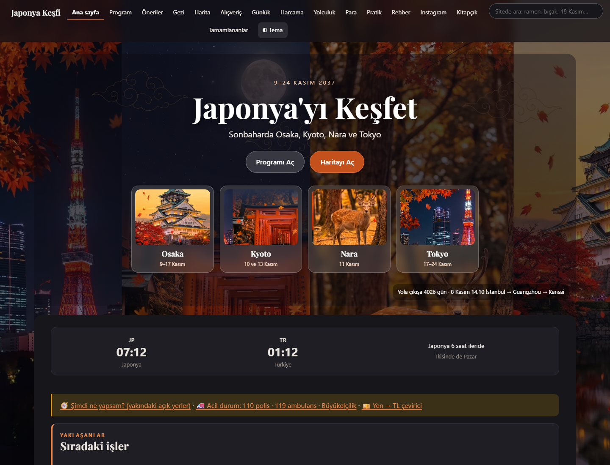
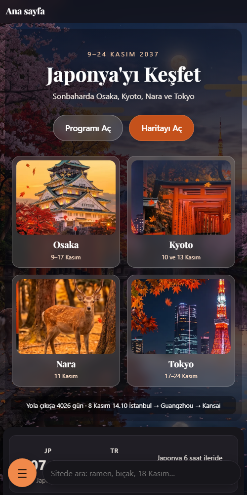
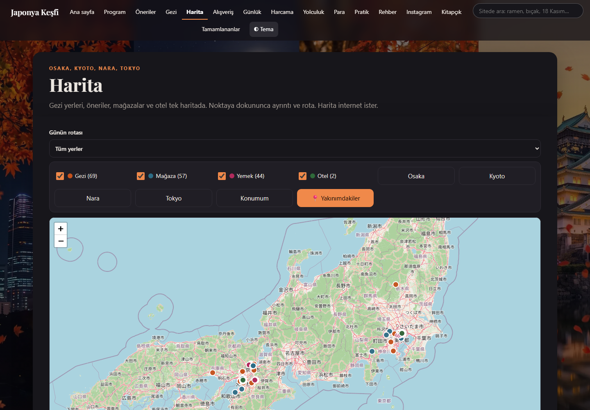
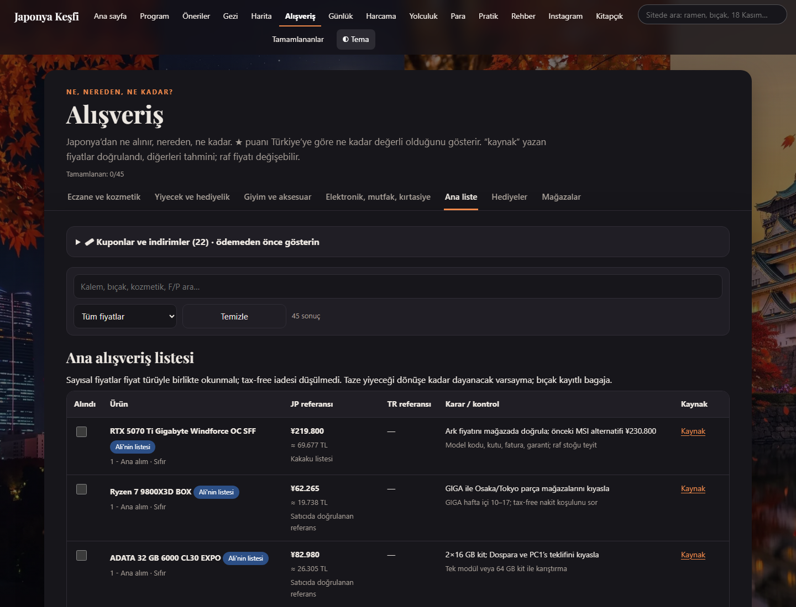
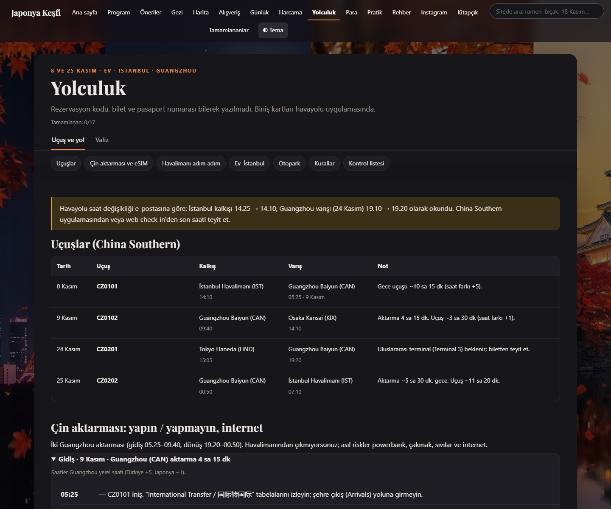
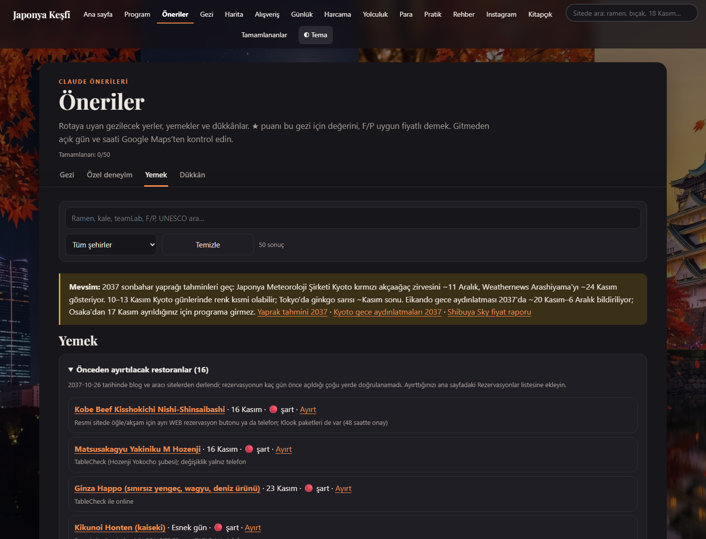
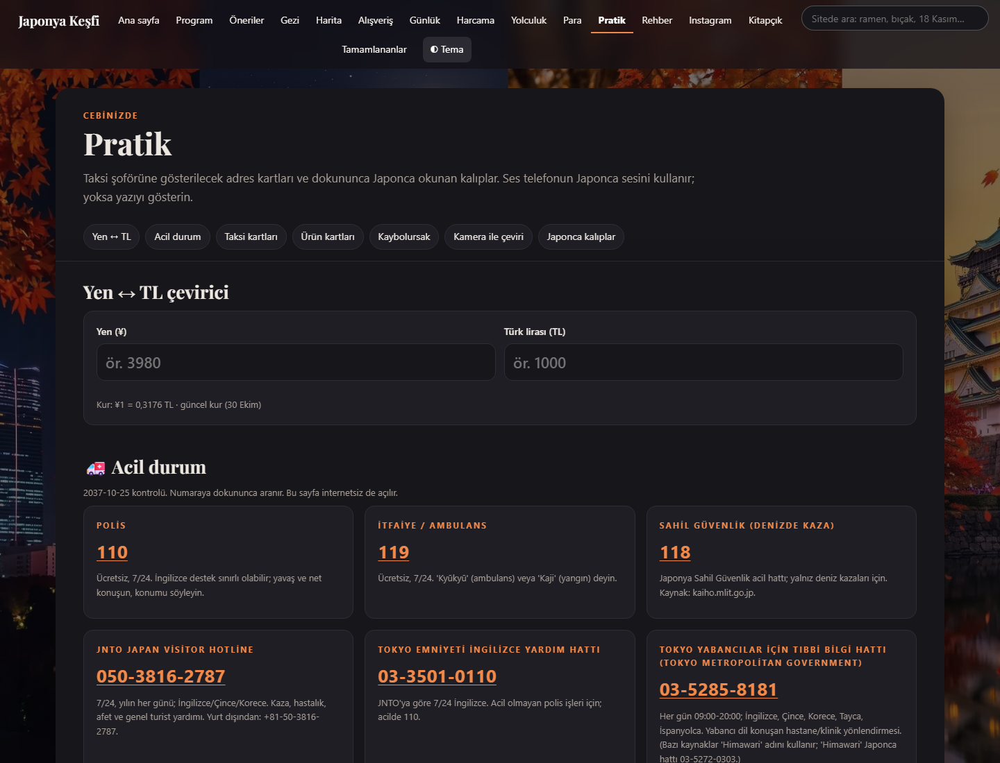
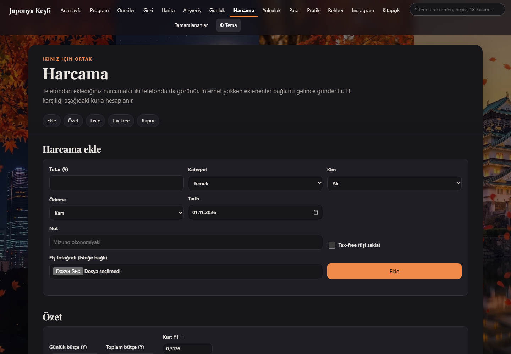
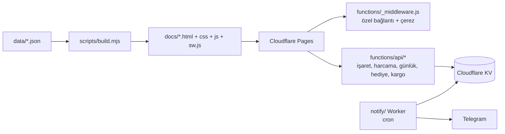

# Japonya Gezi Planlayıcı

İki kişilik bir Japonya gezisi (Osaka · Kyoto · Nara · Tokyo) için yapılmış, telefondan kullanılan kişisel gezi sitesi. Gün gün program, harita, alışveriş listesi, ortak harcama defteri, yolculuk rehberi ve Telegram bildirimleri tek yerde.

Bağımlılığı olmayan bir Node betiği JSON verilerden statik bir site üretir. Site Cloudflare Pages'te özel bağlantıyla korunur. İşaretler, harcamalar ve günlük iki telefonda ortak tutulur (Cloudflare KV).

> **Örnek veri:** Bu depo, gerçek bir gezi için yapılmış özel bir projenin kişisel bilgilerden arındırılmış kopyasıdır. Kişi adları (Ali, Ayşe), oteller ("Örnek Otel"), uçuş numaraları ve tarihler (2037) kurgusaldır. Rezervasyon kodu, bilet, pasaport veya telefon numarası yoktur. Yerler, mağazalar, fiyatlar ve kurallar 2026 sonbaharında resmî kaynaklardan derlenmiştir; kullanmadan önce güncelliğini kontrol edin.

<p align="center">
  
  
</p>

## Neler var

| | |
|---|---|
| **Program** | Gün kartları: saatli duraklar, ulaşım bacakları (hat, istasyon, yön, yaklaşık dakika), o gün alınacaklar, yağmur planı, buluşma noktası, kalabalık ve yürüme tahmini. Her durakta Google/Apple Haritalar yol tarifi. |
| **Harita** | Leaflet haritasında gezi yerleri, mağazalar, restoranlar ve oteller. Günün rotası, konum ve "şimdi açık olan yakın yerler" görünümü (açılış saatleri `hours.json`'dan). |
| **Alışveriş** | Kategorili ürün listesi: Japonya fiyatı, TL karşılığı, Türkiye fiyatıyla kıyas, kaynak bağlantısı, "kimin listesi" etiketi, kuponlar, tax-free notları. İşaretler iki telefonda ortak. |
| **Öneriler** | Restoran, dükkân ve özel yerler; rezervasyon rehberi, Commons fotoğrafları (fotoğrafçı ve lisansla). |
| **Yolculuk** | Uçuşlar, aktarma adım adım çizelgesi, powerbank/ilaç/drone kuralları, eSIM karşılaştırması, valiz düzeni, jet lag planı, kontrol listesi. |
| **Harcama** | Ortak harcama defteri: kişi, kategori, yen/TL, fiş fotoğrafı, tax-free fiş listesi, CSV rapor. |
| **Pratik** | Taksi kartı, Japonca kalıplar, kamera ile çeviri rehberi, acil durum kartı, yen↔TL çevirici, hatırlatma takvimi. |
| **Günlük** | Gün gün not ve fotoğraf (telefonda küçültülüp KV'ye yazılır). |
| **Kitapçık** | Tüm planın yazdırılabilir/PDF hali. |
| **Arama** | Tüm sayfalarda tek arama kutusu (bölümler, kartlar, günler). |

Ayrıca: koyu/açık tema, çevrimdışı kullanım (service worker), tamamlananları gizleme ve geri açma, "Bu telefon kimin?" seçimi.

## Ekran görüntüleri

| Program | Harita |
|---|---|
|  |  |
| **Alışveriş** | **Yolculuk** |
|  |  |
| **Öneriler** | **Pratik** |
|  |  |
| **Harcama** | |
|  | |

## Nasıl çalışır



- **Veri:** Tüm içerik `data/` altındaki JSON dosyalarında (`trip.json` saatli program, `plan.json` gün kartları, `mustbuy.json` / `shopping.json` alışveriş, `picks.json` öneriler, `transport.json` ulaşım bacakları, `travel.json` yolculuk, `pratik.json` hatırlatmalar…). Şema: [SCHEMA.md](SCHEMA.md).
- **Derleme:** `scripts/build.mjs` bağımlılık olmadan `docs/` altına sayfaları, özetli CSS/JS'i, arama dizinini ve service worker'ı yazar.
- **Erişim:** `functions/_middleware.js` tüm siteyi korur. `?k=<anahtar>` bağlantısı bir kez açılınca bir yıllık çerez bırakır; kodda yalnız anahtarın SHA-256 özeti durur.
- **Ortak veri:** `functions/api/*` uç noktaları işaretleri, harcamaları, günlüğü, hediye ve kargo listelerini KV'de tutar.
- **Bildirimler:** `notify/` Worker'ı cron ile sabah/akşam Telegram özeti gönderir (günün durakları, hava, rezervasyonlar, alınacaklar). Gezi sırasında 10 dakikada bir deprem (P2P地震情報) ve tren aksaklığı uyarılarını kontrol eder.

## Kendi geziniz için

```bash
npm run build
```

```bash
npm test
```

```bash
npm start
```

`npm start` siteyi `http://127.0.0.1:4173` adresinde yerel olarak açar. Yeni bir gezi için `data/` dosyalarını kendi planınızla değiştirin; testler saat çakışmalarını, kırık bağlantıları ve kaynak anahtarlarını denetler. Sistemin tamamını bir yapay zekâ asistanına baştan kurdurmak için [PRD.md](PRD.md) belgesine bakın.

### Cloudflare'e yayınlama

1. Bir KV namespace oluşturun ve kimliğini `wrangler.toml` ile `notify/wrangler.toml` içindeki `<KV_NAMESPACE_ID>` yerine yazın.
2. Rastgele uzun bir erişim anahtarı üretin. SHA-256 özetini Pages projesinde `KEY_HASH` ortam değişkeni olarak ayarlayın. Bu ayar yapılmadan site hiçbir anahtarla açılmaz.
3. Siteyi yayınlayın: `npx wrangler pages deploy docs --project-name <proje-adı>`.
4. Bildirimler için `BOT_TOKEN` ve `CHAT_ID` gizli değişkenlerini Worker'a ekleyip `npx wrangler deploy -c notify/wrangler.toml` çalıştırın.

## Notlar

- Fiyatlar, saatler ve kurallar derlendikleri tarihteki resmî kaynaklara dayanır; doğrulanamayan fiyat `null` bırakılmıştır. Gezi öncesi tekrar kontrol edin.
- Saatler önerilen program saatleridir; canlı sefer veya peron bilgisi değildir.
- TL dönüşümleri sabit bir planlama kuruyla yapılır, banka kuru değildir.
